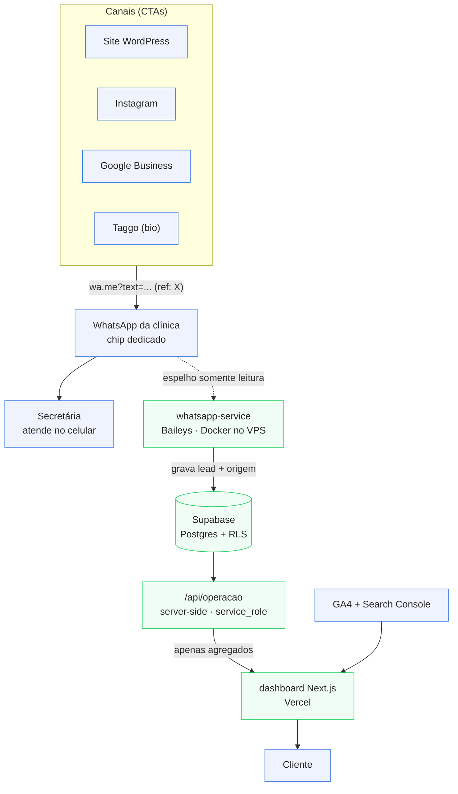

# Arquitetura

> Estado em **11/08/2026**. Atualize este documento quando uma decisão de arquitetura mudar,
> não a cada commit.

## Visão geral



A linha pontilhada é a chave do desenho: o Baileys **espelha**, não intercepta. A secretária
continua atendendo no celular dela, sem saber que o serviço existe.

## Componentes

| Componente | Stack | Onde roda | Responsabilidade |
|---|---|---|---|
| `dashboard/` | Next.js 16, React 19, Tailwind, shadcn/ui, Recharts | Vercel (Root Directory `dashboard/`) | Telas `/` (GA4), `/seo` (Search Console), `/operacao` (leads) |
| `whatsapp-service/` | Node 22, Baileys 6.7.24, supabase-js | Docker num VPS (Hostinger) | Escuta `messages.upsert`, resolve telefone, parseia origem, grava lead |
| `supabase/` | Postgres gerenciado | Supabase Cloud | `contacts`, `pipeline_events`, `messages` + migrations |

## Fluxo de um lead

1. Pessoa clica num CTA. O link é um `wa.me` com `?text=` pré-preenchido carregando a tag de
   origem — ex.: `Olá! Quero agendar uma avaliação. (ref: site pag: home)`.
2. A mensagem cai no WhatsApp da clínica. **A secretária responde normalmente pelo celular.**
3. Em paralelo, o `whatsapp-service` (pareado como aparelho conectado) recebe o mesmo evento.
4. O serviço resolve o telefone real via `key.senderPn` — o WhatsApp endereça por LID
   (`<id>@lid`), que é um ID interno e não serve como identificador de lead.
5. `parseOrigin()` extrai a origem da 1ª mensagem: tag `(ref: X)` primeiro, palavra-chave como
   fallback, `direto` quando não há pista.
6. Grava em `contacts` (telefone único) + um `pipeline_events` com estágio `novo`. Contato já
   conhecido só atualiza `last_seen`.
7. O dashboard lê agregados por `/api/operacao` e desenha KPIs, série diária, origem e funil.

**O serviço nunca envia mensagem.** É leitura pura.

## Modelo de dados

```
contacts          phone (unique) · name · origin · origin_detail · current_stage
                  first_seen · last_seen
pipeline_events   contact_id → contacts · stage · note · changed_by · changed_at
messages          contact_id → contacts · direction · body · ts     [não usada ainda]
```

`lead_origin`: `site` · `instagram` · `google_gbp` · `taggo` · `direto` · `outro`
`lead_stage`: `novo` · `em_atendimento` · `agendado` · `compareceu` · `perdido`

`messages` existe no schema mas **não é populada** — decisão de LGPD, ver abaixo.

## Segurança e LGPD

**RLS deny-all** (migration `0002_rls_lock.sql`). As três tabelas têm Row Level Security ligada
e nenhuma policy. Isso importa porque o dashboard é público e a `NEXT_PUBLIC_SUPABASE_ANON_KEY`
vai para o browser de qualquer visitante — sem RLS ela leria a `contacts` inteira, telefone
incluso.

**Quem consegue ler o quê:**

| Chave | Onde vive | Alcance |
|---|---|---|
| `anon` | browser (público) | nada — RLS bloqueia |
| `service_role` | env do VPS + env server-side da Vercel | tudo (bypassa RLS por definição) |

**Agregados, não PII.** A rota `/api/operacao` roda no servidor e devolve só contagens. Nenhum
telefone ou nome trafega para o browser. Lista de lead individual só depois do auth.

**Conteúdo de mensagem não é persistido.** Guardamos o mínimo para atribuição de origem.

## Decisões de arquitetura

**Baileys em vez da WhatsApp Cloud API.** A Cloud API exigiria que o atendimento passasse a
acontecer dentro de uma ferramenta. O valor da clínica está no atendimento humano da secretária
pelo celular — o desenho preserva isso e só observa. Custo aceito: risco de ban do número.

**Chip dedicado só para leads.** Isola o risco de ban: se a sessão cair, o atendimento
principal da clínica não vai junto.

**Estado de sessão em volume local (`./auth_info`).** Ponto frágil conhecido: perder o volume
custa um re-pareamento presencial com o cliente. O upgrade natural é mover esse estado para o
Postgres — é o que tornaria o container descartável.

**Agregados no servidor em vez de query no client.** Colocar o Supabase no browser exigiria
policies de leitura sobre dados de lead num painel público. Agregar no servidor resolve o
problema de privacidade e o de performance de uma vez.

**Buckets de dia em `America/Sao_Paulo`.** Agrupar em UTC jogaria lead da noite para o dia
seguinte — a clínica opera em horário de Brasília (UTC-3 o ano inteiro desde 2019).

**Por que o Baileys não vai para serverless/edge.** Avaliado em 11/08/2026. O serviço precisa de
um WebSocket de saída aberto 24/7, crypto nativa (libsignal), estado em disco e reconexão.
Workers são escopo-de-request e escalam a zero; Containers são disparados por request e dormem
ociosos. É incompatibilidade de formato, não preferência. O dashboard, esse sim, é portável para
qualquer serverless. Se um dia houver multi-tenant (1 sessão WhatsApp por cliente), o alvo
natural é uma máquina always-on por tenant (ex.: Fly.io machines), não edge.

## Operação

**Acesso ao VPS:** SSH direto na porta 22 **não funciona**. Use o console web do hPanel
(VPS → Docker Manager → Web console).

```bash
cd /opt/clinica-crm/whatsapp-service
docker compose logs --tail 40          # ver ingestão
docker compose up -d --force-recreate  # reiniciar
```

**Gotchas conhecidos:**

- **O Docker Manager do hPanel não parseia nosso `docker-compose.yml`** (usa `build:`, e o
  editor do painel espera `image:`). O botão Deploy fica desabilitado. Risco real: alguém
  "consertar" o YAML ali e deployar — se a reescrita dropar o volume `./auth_info`, a sessão
  morre e exige re-pareamento com a clínica. Gerencie o stack pelo terminal.
- **O console web da Hostinger mascara JWT ao colar.** Para gravar chaves no `.env` do servidor,
  passe em base64 em pedaços curtos e decodifique lá.
- **Env var nova na Vercel só vale em deployment novo.** Clicar "Redeploy" no painel pode não
  bastar — force um build (commit vazio).
- **Ruído normal nos logs do Baileys:** `code=515` logo após parear, `failed to decrypt message`
  em mensagens `fromMe`, `408 init queries Timed Out`. Nada disso afeta a ingestão.
- **Contato recorrente não imprime log** — só `[lead] novo` aparece. Confira no Supabase.

## Estado atual

| Fatia | Estado |
|---|---|
| F0 · Fundação (Supabase + schema) | ✅ |
| F1 · Ingestão (Baileys + parser + repontar CTAs) | ✅ |
| F2 · Visualização (`/operacao`) | ✅ |
| F2 · Auth + LGPD | ⬜ |
| F3 · Pipeline ativo (CRM da secretária) | ⬜ |

**Limitações conhecidas hoje:**

- O funil mostra 100% em "Novo" porque só o Baileys escreve, e ele sempre cria em `novo`. Ganha
  vida quando existir a tela da secretária (F3).
- Mensagens de números internos (staff, profissionais da clínica) entram como lead. A ignore-list
  está despriorizada — a limpeza é retroativa.
- Origem `direto` alta indica CTA sem a tag `(ref: X)` — vale auditar canal por canal.
